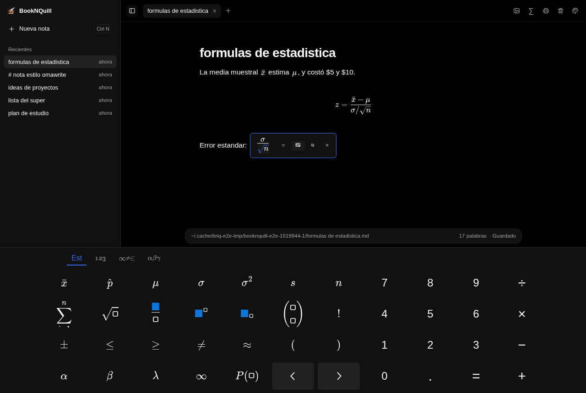
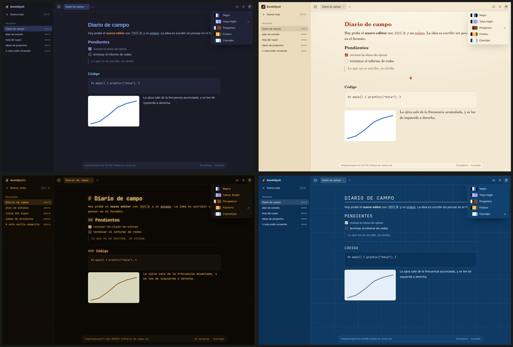

<p align="center"></p>

# BookNQuill

A quiet desktop notes app. Open it, start writing, and find the note again in your recent list.

- **Plain files.** Every note is a Markdown file in `~/Notes`. Other editors open them as usual.
- **Writes like a word processor.** `# Title` turns into a heading as you type; lists, tasks, bold and code work the same way.
- **Images without paths.** Paste a screenshot, then resize, align, rotate, crop or drag it. The file keeps a normal Markdown link, with the width stored the Obsidian way (``).
- **Math without LaTeX.** Type `$` (or `Ctrl M`) and write like on a calculator: `/` makes a fraction, `^` a power,
  `raiz`, `suma`, `xbar`, `phat`, `mu` and `sigma` become symbols, and `Alt R`, `Alt S`, `Alt B` insert a root, a sum and a bar.
  `Ctrl Enter` writes the result, the ⌨ button opens an on-screen keyboard with a statistics page, and `Ctrl P` exports to PDF.
  The file keeps standard `$…$` math, which Obsidian and GitHub render too.
- **Words to formula.** Select "raiz de n sobre sigma" and press `Ctrl M`: Claude Haiku turns it into the formula.
  It needs an Anthropic API key in `~/.config/booknquill/anthropic-api-key` (or `ANTHROPIC_API_KEY`).
- **Five themes.** Negro, Tokyo Night, Pergamino (serif on paper), Fósforo (amber CRT) and Cianotipo (blueprint). Pick one from the palette button in the top bar.
- **Zoom.** `Ctrl +` and `Ctrl -` (or `Ctrl` + mouse wheel) scale the whole window, `Ctrl 0` resets it. The level is remembered.
- **Sorts itself.** An optional classifier ([jev](https://typesafe.ai)) files each note under a category. Without an API key you pick the category yourself.





Built with Tauri 2 (Rust core), React and Tiptap.

## Install (Linux)

```sh
./scripts/install-local.sh
```

It builds a release binary and installs it to `~/.local/bin/booknquill` with a desktop entry.
`booknquill --new` opens a fresh note; if the app is already running, it opens the note there.
On Hyprland, bind it to a key:

```ini
bind = SUPER, N, exec, booknquill --new
```

Notes go to `~/Notes`. Set `BOOKNQUILL_NOTES_DIR` to use another folder.

## Development

Needs Node 22+, pnpm and Rust (with `cargo install tauri-cli`).

```sh
pnpm install
pnpm tauri dev      # the app, with hot reload
pnpm e2e            # end-to-end tests
```

The E2E tests drive the real UI in Chrome against the real Rust core: the `e2e_bridge` binary serves the
same `Notes::dispatch` the app uses over HTTP, and each test gets a fresh copy of `e2e/fixtures/notes`.

## Status

Early development. Linux (Wayland, Hyprland) is the first target.

## License

MIT
